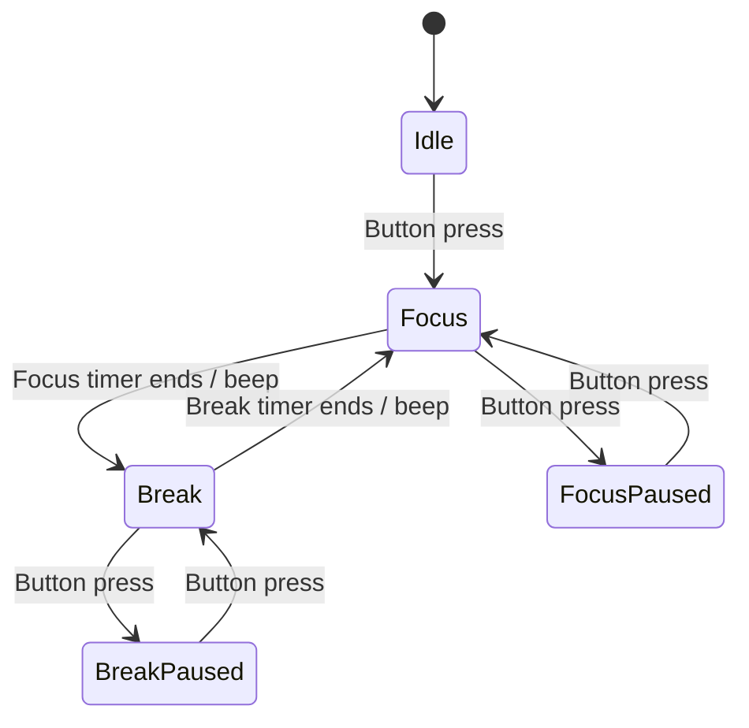

# FocusBox

A breadboard Pomodoro timer written in C for a GD32VF103 board. It uses one button to start/pause, green and blue LEDs to show focus and break, and an active buzzer for a short phase-change alert.

## Current prototype

The current firmware is hardware-tested with accelerated intervals: 10 seconds of focus, 5 seconds of break, and a 1-second buzzer alert on each transition. A short press starts or pauses the timer; pressing again resumes with the saved remaining time. Pausing turns off both LEDs and silences the buzzer.

For everyday use, change the two interval definitions in `src/main.c` to:

```c
#define FOCUS_MS (25ULL * 60 * 1000)
#define BREAK_MS  (5ULL * 60 * 1000)
```

The prototype currently alternates focus and short breaks. It does not yet implement a long break, long-press reset, stored session history, or a display.

## How it works



The button starts, pauses, and resumes the timer.
Green indicates focus, blue indicates a break.
A buzzer sounds when the phase changes.

## Hardware

- GD32VF103 development board and USB cable
- Breadboard and jumper wires
- One momentary pushbutton
- Green LED and blue LED, each with its own 1 kΩ series resistor
- Active buzzer rated for 5 V
- 2N2222-family NPN transistor and 1 kΩ base resistor
- 1N4007 diode across the buzzer (recommended for an electromagnetic buzzer)

See [wiring guide](focusbox/docs/wiring.md) before assembling. GPIO pins use 3.3 V logic; never connect 5 V to a GPIO.

## Controls and indicators

| Part | Board connection | Behavior |
|---|---|---|
| Button | PA5 to GND | Press to start, pause, or resume |
| Green LED | PB0 through its resistor | Focus period |
| Blue LED | PB1 through its resistor | Break period |
| Buzzer driver | PB10 through 1 kΩ to transistor base | Brief alert at phase change |

## Build and flash

This project uses the course GD32 Makefile and SDK layout. The Makefile expects these sibling folders relative to the project directory:

```text
project-folder/
├── focusbox/       # this repository
├── firmware/
├── compiler/bin/
└── programmer/
```

Open a terminal in `focusbox/` and run:

```sh
mingw32-make
mingw32-make dfu
```

The SDK, RISC-V compiler and DFU programmer are external dependencies and are not included here. Use the same course toolchain that successfully built and flashed the prototype. After flashing, press RESET to run the firmware.

## Repository layout

- `src/main.c` — timer, button filtering, LEDs and buzzer control
- `docs/wiring.md` — breadboard connection guide
- `docs/PLAN.md` — project scope and next improvements
- `hardware/` — add your own wiring photo or schematic here
- `Makefile` — course build and DFU upload rules

## Known limitations

- The timing conversion uses the GD32 course SDK's `get_timer_value()` and `SystemCoreClock` setup; verify accuracy against a reference clock before presenting timing precision as measured.
- Transistor lead order varies between 2N2222/PN2222 variants. Follow the lead arrangement that was physically tested with your specific transistor; do not identify its pins from a generic picture alone.
- Add a clear photo of the finished circuit and a short demo recording before publishing the repository.
